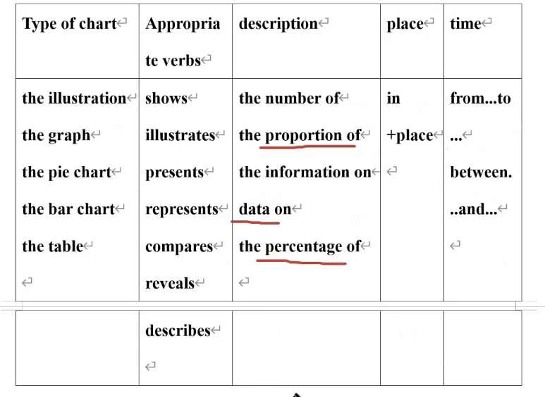
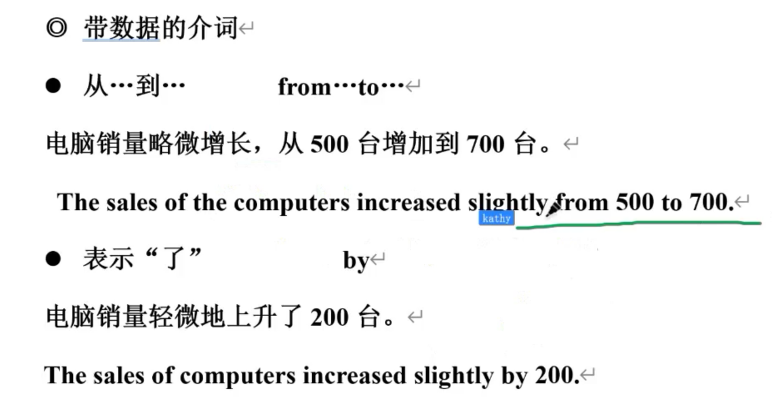
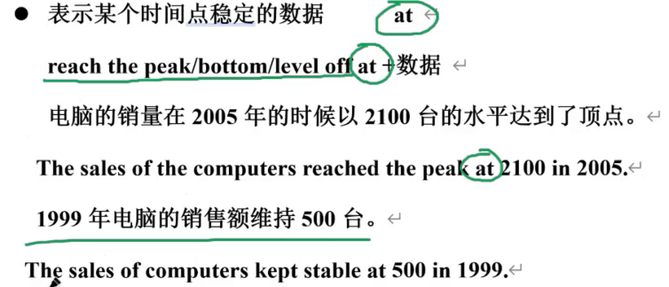
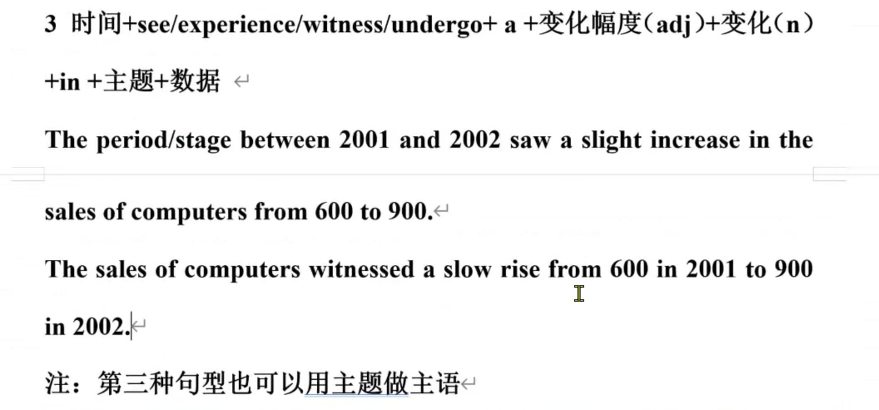
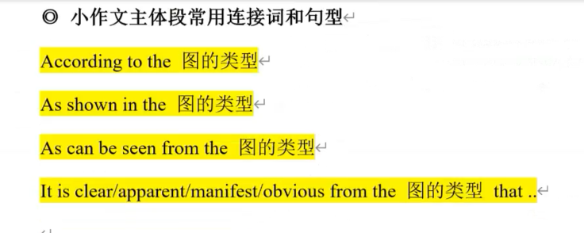

wild swings大幅度的波动
	fluctuate between A and B

常用词

has aroused debates across the globe

approximately = close to

contrast

tendency

whereas = while 然而

reach the peak at 数字。

percentage/proportion

counterpart 对应的事物

opposite = reverse 相反的

twice the percentage/amount of 

celsius 摄氏度

With regard to

it mirror that 这反映了

harness 利用

bridge the gap between rich and poor 减小。。差距

hierarchy

In contemporary society

predominantly

strategy

inequality

Exaggeration

## 各种机构

According to the 2021 annual report by the Ministry of Education of China 教育局

According to the related report by the Tsinghua University

Tsinghua University

美国统计局：the Statistic

# task2

好用的词汇

dilemma 替换掉problem

mindset 替换 ways of thinking

detrimental

hierarchy阶级  替换 class

subtly 潜移默化地

subconsciously 潜意识地

irreversible 不可逆的

essence 本质

cutting-edge 尖端的

entice 吸引 替换attract

strategy

infrastructure

compromise

harbour 替换 hold 但这个专指坏的“v. 抱有”

pool 替换 collect   v.收集

## 教育类

德：

Improve moral standard	

智：

theoretical knowledge

independent and critical thinking

analysing skills and problem-solving ability, 

communication and social skills

adapt to new environment

体：

develop physical fitness

healthy lifestyle

美（Psychological心理）：

书法：calligraphy

psychologica:

self-cultivation, an appreciation of art and literture

劳：

动手能力：manual skills, hands-on skills

work: practical skills, improve career/vocation prospects

## 科技类

科技类的影响：

积极：

improve production speed, work efficiency, more leisure time

Convenience, saving on commuting costs

Promote and facilitate communication, expand social circle	促进交流，加强沟通，扩大社交，扩大朋友圈

Reduce carbon emission, paperless office

消极：

方面：隐私问题，网络安全问题，心理问题，社交关系问题，沉迷问题

双刃剑：double-edged sword

Invade one’s privacy	侵犯个人隐私，个人信息受到了威胁

Security issue, cyber crimes

Less quality family time, increasing work pressure

电子产品：electronic devices;digital product  固定搭配不能乱

不良内容传播，如色情、暴力对青少年的影响
Questionable contents, pornography, violence, negatively affect 
teenagers/have a negative effect on teenagers
身体健康问题，电子产品辐射，视力下降，户外活动锻炼时间减少
Physical problem, radiation, weaken eyesight, less outdoor exercise

注意考虑健康问题就要像身/心.

Psychological problem, 

indulge in virtual world, become solitary, 

be isolated from the real world, 

weaken the relationships with family members and friends

The rapid development of science and technology has increased the pressure on people to keep learning and the need to constantly 
update their professional knowledge and skills

沉迷：be addicted to sth、people indulge in sth

忽视：overlook ,neglect ,ignore

## 社会类

### 老人相关

弱势群体：disadvantaged/vulnerable  group

老龄化社会：the aging society

well-rounded caring system

effectively eliminate their loneliness

demographics

twilight life

elderly/senior  老年的

pension 养老金

### 孩子

impressionable 易受影响的 = be prone to 

addictive

discipline

couch potato 看电视太久的人

naughty 顽皮的

 

优势

curiosity,imitate,quick to learn

劣势

lack of self-control, unable to distinguish right from wrong

### 工作和家庭

忽视

workaholic 工作狂

career path

colleague

intense competition

fast-paced 快速的

fatigue 疲劳

job-hopping 跳槽

workplace 职场

**泛用的特点**

keen competition makes employees to work overtime

spend more time learning new tecknologies and upgrading

conflicts

## 环境

Climate change, 

global warming 

Energy crisis, water shortage, 

deforestation 

industrialisation, 

urbanisation, 

fast-paced work and life style 

globalisation, 

technology

### 原因

population growth

industrial development

long-term human activities

### 方法

世界方面：

Global collaboration/cooperation, reach the agreement, set international standards for environmental protection

政府方面：

Make laws, encourage low carbon economy

科技方面：

Exploit renewable, green energy, invest in energy-saving technologies

公司方面：

Promote environmentally friendly products, lead green consuming habits

个人方面：

Raise public’s green awareness, encourage low carbon lifestyle

## 经济发展 城市化

urbanization 城市化

rural areas

population density

well-being

liable

好处

more job opportunities, higher income

坏处

at the cost of environment

contamination = population

the over-concentration of population may result in a quicker spread of diseases

increase the burden of government management

## 媒体

an unhealthy social atmosphere

新闻界 press

unveil

coverage 新闻报道

exaggerate  夸张

supervise 监督

mislead 误导

hook 吸引

优点

disclose social problems

minitor and push the government to deal with 

缺点

over-report negative stories to hook viewers and maximise profits

## 广告

生活必需品：daily necessities

好处

坏处

add to the cost of the products

claim product's advantages only;unjust

unwelcome information

副作用：side effects

市场营销方式 ：marketing tool

## 犯罪

延长刑期：give longer prison sentences

反社会人格：anti-social

改造：rehabilitation

罪犯：criminals = offenders

# 说明文

## 环境类

# task 1

show /illustrate/indicate/reveal

## 句型多样

1. 人做主语:american adults took up 37%
2. 数字做主语:37% of sth ...
3. 百分比做主语    the proportion of sth was 37%
4. there be 句型

### 精确 vs. 模糊

两个方面加起来占多少，最小的是多少

### 相反的

by contrast = in contrast = contrarily = on the contrary

### 括号

类别和数据都可以用括号

 the two categories of sth ...

### 最高级的表达

none of xxx enjoyed doing sth more the those YYY    没有。。。比YYY更加。。

## 开头段模版

## 带数据的介词

顶点，底点，平衡点都用at

## 四种主要的描述句式

其他几种直接看写作真经

## 小作文常用连接词和句型

## 饼图

### 概述段

看最大最小值

大多数：most of = the majority of 

同时：while = whereas

比例：ratio =percentage = proportion

占比：account for = occupy = take up = make up = comprise

## 柱状图

### 概述段

1. 横坐标分别的加起来比较最大值最小值
2. 比较横坐标上的最大最小差值
3. 比较横坐标上哪些都是一边大于另一边，进行分类概述,就比如说

### 泛用

除了：beside=with the exception of sth = except for 

其他：the rest of = the remaining = the other 

类别：category/kind/sort/type/group

关于：with regard to 

## 整体趋势句

## 流程图

全面性覆盖

逻辑连接词

commences with

subsequently

culminating in 结束于

concurrently with

prior to 

upon completion of 

条件状语：

provided that(已知) 。。,the next phase ...

following ...,the ....

非限制性定语从句

the belt ,**which is ...,** has...

### 泛用词

步骤：steps=stages=procedures=processes=phases

经过：experience = undergo= go through

管道：channel=tunnel=tube

摄氏度：Celsius

### 概括段

总体而言：【原材料】+【几步】+【最终产物】

### 主体段

# 地图题

## 泛用词

东西走向的路：a main road which ran from east to west./a main road **running** from east to west./an east-west main road

继续向（南）：continuing south,/further south,

被替换：be taken over /be replaced by

定位

xxx was located/situated to the (direction) of YYY

XXX was located/situated on the (direction) side of YYY

XXX was located/situated in the (direction) part of YYY

XXX was located/situated at the (direction) corner of street 1 and street 2

## 概述段

总体而言，在这个【学校。。。】里

