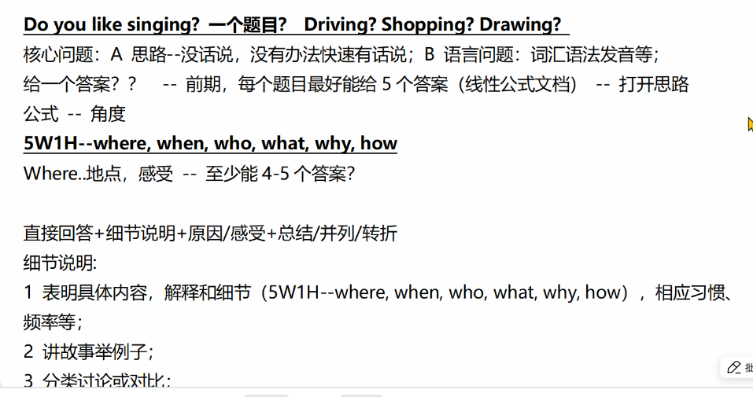
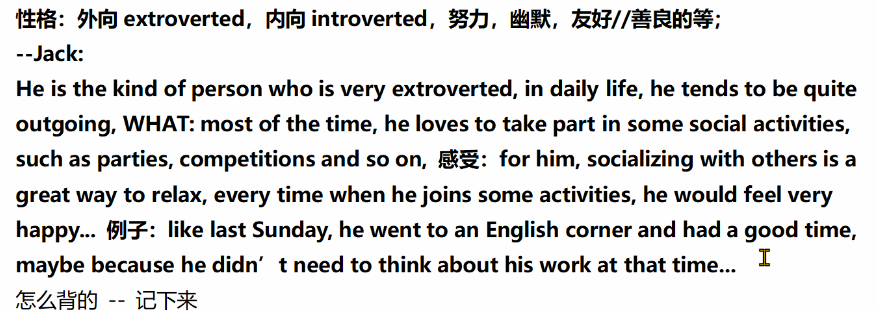
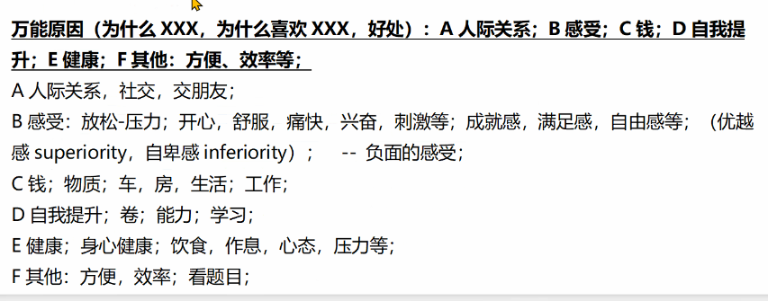
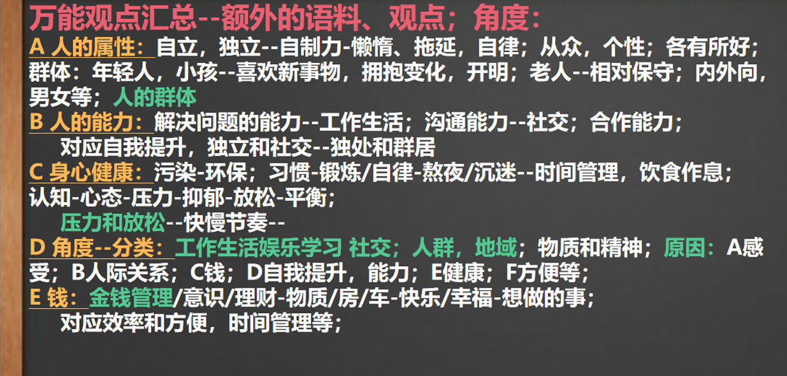
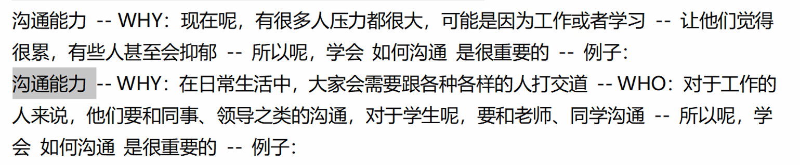
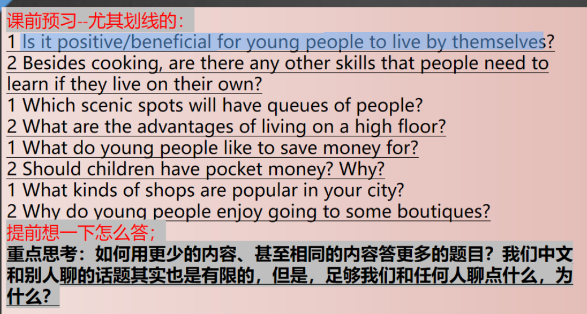

# 口语上课笔记







<a id = "signal"></a>

## 万能语料



```
常用句型
there is a common belief that ... but in my view...	有一种普遍的看法是……，但在我看来…
I can often remember the （dreams） I had,especially if they were vivid or emotional。	我总是可以记起。。如果它是生动有情感的。
stick to a  routine  of	坚持一个常规的。。。
people's lives are overwhelmed by a multitude of trivial matters	人的生活被大量琐事所淹没
gets in the way of their improvement 	妨碍他们的提升.
This is because popularity often depends on various factors such as personality,behavior,and interpersonal skills rather than job titles alone.
learn about how the （world） works and the principles behind （natural phenomena）.
from the asperct of ...,
```

```
A	人际关系
make a great first impression	留下好的第一印象
attract sb to approach sb.	吸引某人接近某人
increase the likelihood of starting a conversation and forming a friendship
help to build trust and intimacy /ˈɪn.tɪ.mə.si/ in friendships

建立关系
establish/forge/build a relationship：建立关系
make connections with：与…… 建立联系
initiate a friendship：开启一段友谊
strike up a conversation：开始交谈
```

```
B	人的能力
they often display a positive attitude and a willingness to help others,which fosters a  collaborative   and   supportive   work   environment
```


```
C	身心健康
escape from my daily routine	摆脱日常生活的压力
gives sb a chance to unwind		让某人有机会放松
I took a walk by the lake, enjoying the cool breeze. The water was calm, the air smelled fresh, and it just felt so peaceful—like all my worries drifted away for a while.
```

intreverted

```
D	自我提升
helps me grow as a person by experiencing different cultures	通过体验不同的文化，帮助我作为一个人不断成长
能力：
时间管理
金钱管理
自我管理（自律）
沟通能力
exhibit（ [ɪɡˈzɪbɪt]）  excellent  interpersonal skills and emotional intelligence	表现出优秀的交际技巧和情商

```



```
have some spare time 
a good way to relax 
which is located near my home 
a huge part of my life 
about three times a week
when i am reading ,ijust ...,besides,after reading ,i would ...
to be honest 
i don't use it very often 
at this time 	这个时候
I am a perfect example (of this).	我是个“典型案例”
if my memory serves me right	如果我记得没错
be struggling with 	挣扎做某事
many kinds ... the first one i think of is ....
no matter in the north or in the south of china ...you can always see some ...
```

if my memory serves me right	如果我记得没错

it was three years ago,a teacher called zhangxuefen **unexpectedly became an internet celebrity.**

he was keeping searching imformation about selecting school and give some advice like make a schedule for some peoples who want to get degree of bachors or masters.

*For example , he often gives advice to students who just finished the China's national college entrance exam, and recommends suitable universities based on their scores.*

in my opinion ,there is too much adolessents who haven't clear plan about ther future in china ,at that time ,his existeace became a perfer way for these students to learn something about it.




Absolutely! Living independently teaches young people essential life skills, especially **cooking** and **money management**, which are crucial for adulthood.

Take my friend Jack as an example. He used to live alone in a small apartment on the top floor of his building. At first, he relied heavily on takeout and his parents’ monthly allowance**[əˈlaʊəns]**. However, after realizing how much money he was wasting, he started learning to cook simple, healthy meals like pasta and stir-fries. Not only did this save him money, but it also improved his diet.

Additionally, managing his own expenses—like rent, groceries, and utilities **[ju'tɪlɪtɪz]**—forced him to budget carefully. He even set up a savings plan to avoid overspending. These experiences made him more responsible and self-reliant **[ˌselfrɪˈlaɪənt]**.

In short, living alone pushes young people like Jack to develop **practical [ˈpræktɪkl] skills** and **financial discipline**, preparing them for future challenges.


## 万能的原因


**1 Do you like wearing T-shirts?**

Yes ,i like wearing T-shirts .In summer ,particularly,wearing T-shirts made me feel more cooler which is a efficient way to facing the hat weather.

**2 Do you go running a lot?**

Yes,indeed .i like running at night ,cause i think running can improve my physical fitness and refresh my spirit which allow me to concentrate on something matter.

no .as a fierce

**3 P3-Are children' s opinions influenced by their parents?**

yes ,there is no doubt that parents play a crucial role in children's growth and i believe that parents' education is the most important thing to cultivate kids' idea.

**4 P3-Can you provide some examples of family businesses in you**
country?

sorry,i don't have any konwledges about it .if it is not too much trouble ,could you change a question please ?

**1 How often do you use maps on your phone?**

regularly Beyond twice a week. However ,if i take a trip to other place ,it will up to twice a day maybe.Without using a map,particarly ,in an unfamlimar place ,i can't even find a bus station.

maybe three times a week.As a student ,actually ,going out to some places unfamilar isn't a routine and  it is unnecessary for me to use a map  in my campus. 

**2 What kind of clothes do you like to wear?**

i like to wear T-shirt which made me feel comfortable.

**3 P3-Why do people like parties?**

as we all know,Party is common way to create a relationship with others.When people in parties ,they can enjoy some food ,drink and sing along with their friends .

**4 P3-What rules should people follow when using public transports**
**1 Have you seen any movies with lots of fish?**

yes ,i have seen a movies with a lot of fish which called demon fish. this fish is very aggressive

**2 Did you often watch films when you were a child?**

yes ,i often watch films when i was a kid.i like some magic movies at that time ,such as 哈利波特，which lead me into a world of illusion. 

**3 When was the last time you went running?**

perhaps one month ago. actually i have a lot of emergincy things to deal with .currently ,i have to prepare to graduate .

# Part	One

## Cars

单词：

 environmental	环境的，环保的

**perspective**	观点角度

vehicles	[ˈviːɪk(ə)l]	n.车辆

knowledge

**aesthetic**	[iːsˈθetɪk]	n.美学；美感；审美观 	adj.审美的；

manipulate	v.操纵

automobile	[ˈɔːtəməˌbiːl]	n.〈美〉汽车	v.开汽车；坐汽车	adj.自动的

词组：

sing along to sth 	一起唱sth

sing along with sb 	和谁一起唱

lack sufficient knowledge of 	缺少关于什么的知识


1. Did you enjoy traveling by car when you were a kid?
   Yes,actually it has been one of my favoriate activities.when i was a kid  ,my parents  always exciting to go on road trips ,and we enjoyed singing along to our favorite songs and talking about daily life .Without a doubt ,that was a wonderful time .
2. .What types of cars do you like?
   In fact ,I lack sufficient knowledge of **automobiles**,so from an **environmenta**l **perspective**，i prefer to select **electric  vehicles**.As for **aesthetics**,i would like to choose a red sports car  without hesitation.
3. Do you prefer to be a driver or a passenger?
   I prefer to be a driver .I enjoy the sense of **control** and freedom which *you can't experience*  as a passenger.

## plants

The lotus is such a special plant in my country—it's not just beautiful, it's deeply meaningful. Even though it grows in muddy ponds, it rises above the water to bloom into these perfect, clean flowers. That's why it's always been a symbol of purity, strength, and wisdom in our culture. The lotus is useful too! We eat the roots in soups and stir-fries, snack on the seeds in desserts, and even use them in traditional medicine. The big leaves are great for wrapping food, giving it a fresh, earthy smell.

## ai

Some people worry that Al might replace human workers in certain fields.Personally, I think Al should be used to assist workers rather than replace them.If people learn how to work alongside Al, they can focus on more creative and complex tasks while Al handles the routine work.

## 影片（纪录片）

**Documentaries** are like **portals  [ˈpɔːt(ə)lz]** to the **unknown**. **Watching** them is a **perfect way** to **unwind** while **fueling** my **curiosity**.What I **love most** is that I can **learn** something **new every time**, whether it's about the **birth** of **stars** or the **challenges** of **interstellar [ˌɪntə(r)ˈstelə(r)]  travel**.

## 散步

**last evening I took a walk by the lake which is located near my home , enjoying the cool breeze. The water was calm, the air smelled fresh, and it just felt so peaceful—like all my worries drifted away for a while.**

## 地点（景点）

A peaceful place I love is Qingyan Ancient Town in Guizhou. It's smaller and less famous than many other old towns, but that makes it more special. The cobblestone streets, old temples, and city walls from the Ming Dynasty give it a tranquil charm. Local people still make traditional snacks like tofu and rice cakes in small shops. I like sitting by the ancient well, watching villagers go about their daily lives. Because it's not touristy, you can really feel the slow, simple way of life there.

## major

1. Do you work or do study?
   I'm studying computer science in Guilin university of electronic technology. The campus of it is large and far from the city center,which provides us with a tranquil study environment .
2. What's your major?
   My major is computer science .It’s an incredibly dynamic and rapidly evolving field that fascinates me. During the study,I’m constantly amazed by how technology can solve complex problems and transform various aspects of our lives, and I’m eager to contribute to this exciting field.
3. Do you have any plans for your studies in the next five years?
   In the next five years, I plan to first complete my undergraduate degree with excellent grades. After that, I will actively participate in research projects related to artificial intelligence and machine learning, aiming to gain practical experience and contribute to meaningful research. 
4. can you introduce the courses of your major
   In my computer science major, several core curriculums shape our learning. It is Programming ,data science,algorithm and artificial intelligence. Among these courses ,Programming is the cornerstone which is versatile and widely used in other fields.

## cuisine

our local cuisine is also very famous. We have a variety of delicious traditional dishes. One of the must-try dishes is [菜名], which is made of [主要食材]. It tastes [味道描述], and the cooking method has been passed down for generations. Whenever there are festivals or family gatherings, this dish is always on the table, bringing people together and creating a warm atmosphere. Besides, [其他特色菜] are also very popular among both locals and visitors

## app or website

I would like to introduce the App Momo to you. Momo is one application used to memorize words, since I was preparing IELTS for the past few months, I had to find out an effective way to memorize necessary vocabulary in order to get better grades. After downloading several applications from the app store, I decided to use Momo as a fixed tool to help me with my test.

And the reason for me to use it often is that it is simple and direct, after all, it is of the greatest use to help me memorize words among all the apps, so I persist in using it every day. The daily plan is divided into 2 parts, including learning new words and going over the learnt ones. Every time you open it, you will face 6 new words, and after you have gone through all these new words, the app will test whether you have completely memorized them. When you are done with this set of words, it will give you another set. And the number of sets of words you learn every day depends on your goal. Whats more, the most amazing part of the app is that it can somehow figure out your memory curve and design your own review plan, and that is the secret for it to be much more useful than other similar apps I have used.

However, after using this app for some time, it started charging me for further study. Thats not that cool, yet understandable, since the programmers need payback, plus it does offer me convenience, anyway, I will still use this app to memorize words in the future.

## 保护环境的人

The environmentally friendly person I want to talk about is my grandma. She is already 83 years old but remains in great
health. Every morning after breakfast, she takes a walk in a nearby park, which usually lasts about an hour. In the evening, she
likes to sit in front of the house and chat with other elderly ladies.

Her way of protecting the environment is quite simple. On her way back from her morning walk, she always carries her
own cloth bag to the supermarket to buy vegetables, eliminating the need for plastic bags. However, she didn' t always do
this.  A year ago, she preferred plastic bags because they were lightweight and convenient. But after I explained to her that plastic bags take hundreds of years to decompose and can be deadly to animals if accidentally ingested, she changed her behavior. Now, no matter where she goes, she always brings her cloth bag with her.

Giving up plastic bags in favor of reusable ones is a simple way to protect the environment, but sticking to this habit is another challenge. Even though many of us are aware of the damage plastic causes, we sometimes still choose it for convenience.

## 帮助别人的经历

if my memory serves me right,that is last year, my cousin jack who was a senior high school student ,was struggling with English grammar and speaking fluency at school.so i offer to help him every weekend. we chose a quiet  cafe which was a comfortable place with warm environment and the smell of coffee in the air.During our session, i concentrated on practicing complex grammar rules and  making a conversation with him by English. 

After that ,when he had a English test,his performance  improved significantly. This made his mother very surprised. And when she found out that I had been helping Jack, she praised me in front of my parents. She said that it was very kind and helpful of me to take the time to assist a family member.

it was a very special experience to me ,not only because i supported his academic progress but also i established a stronger relationship with him.

## When do parents usually praise their children

Parents usually praise their children when they achieve something notable. For example, when kids get good grades in school, parents will be quick to praise them. It could also be when children show good behavior, like being polite to others or sharing toys with their siblings. When a child accomplishes a difficult task, like learning to ride a bike or playing a musical instrument well, parents will praise them to encourage further progress. Also, when kids show creativity, such as drawing a beautiful picture or writing an interesting story, parents will give words of praise to boost their confidence.

## Do you think people should always point out and correct others’ mistakes?

No, I don't think people should always point out and correct others’ mistakes. First of all, the timing is crucial. If we correct someone in public, especially in a harsh way, it might make them feel embarrassed and lose face. In such cases, it's better to wait until we are in private and then have a friendly conversation. Also, not all mistakes are significant. Some minor mistakes might not need to be pointed out immediately. We should consider the relationship with the person as well. If we have a close relationship, we can be more straightforward, but if we don't know the person well, we need to be more cautious. However, in some situations, like in a work - related or safety - critical environment, it's necessary to point out mistakes promptly to avoid bigger problems. So, it really depends on different circumstances.


## colour

**1 P1 Colours** 

What's your favorite colour? 

What's the colour you dislike? Why? 

What colours do your friends like most? 

What colour makes you uncomfortable in your room? 

Have you ever bought something because of its colour?


My favoriate colour is red .There is a common belief that  red is a symbol  of  danger or some horrible things,but in my view red is the colour of flame which bring brightness and warmth  to us .


[跳转万能搭配](#signal)


# Part	Two&Three

#### 节约时间的方法

1. Describe a way/change that helps you save a lot of time

   ```
   You should say:
   What it is
   How you implement it
   How difficult it is
   And explain how you feel about the way/change
   ```
   单词：
   syntax 	[ˈsɪntæks]     n, 语法，结构

   summarize 	[ˈsʌməraɪz]	 v.总结

   edit	['edɪt]

   exceptional 	[ɪkˈsepʃ(ə)nəl]	adj.杰出的

   practical 	['præktɪk(ə)l]	实际的

   documentation	[ˌdɒkjʊmenˈteɪʃ(ə)n]	n.必备资料

   technique	[tekˈniːk]	n.技术

   existence	[ɪɡˈzɪst(ə)ns]	n.存在
   structure	[ˈstrʌktʃə(r)]	n.结构

   adopt	[əˈdɒpt]	v.采用

   optimal 	[ˈɒptɪm(ə)l]	adj.最适宜的

   incredibly	[ɪn'kredəbli]	adv.非常

   existence 	[ɪɡˈzɪst(ə)ns]	n.存在

   effect 	[ˈefə(r)t]	n.努力

   

   ​	One significant way which i equiped that helped me save a lot of time is taking notes by using markdown syntax.as we all known,Note-taking is a common method for summarizing and organizing daily learning outcomes,and using Markdown syntax make **editing** notes exceptionally straightforward.By doing this ,i ensure that a **high-quality** note can be created without having to spend too much time.

   ​	To implement this method ,I start  by reading Readme files submitted by others on Github and learned the basic application of Markdown syntax through **practical** example. Then i visited the official Markdown website **documentation** ,which help me master advanced formatting **techniques**.Now ,i can **proficiently** use this syntax to handle most of my text documentation.

   ​	Actually,learning Markdown syntax is easy,the true difficulty is discovering its **existence** and learning to select **optimal** formatting **structures** for varying content types .

   ​	overall ,adopting this syntax has bean **incredibly** rewarding for me .althought it took some **effort** initially to learn it ,the time saving make it worthwhile.

2. What can people do to save time?
   单词：

   **prioritize**	[praɪˈɒrətaɪz]	vt.按重要性排列，划分优先顺序; 优先处理
   critical	 [ˈkrɪtɪkl]	adj.关键的; (病情或局势)严重的; 批评的; 评论家的; 评判性的

   utilize	[ˈjuːtəlaɪz]	vt.利用，使用

   streamline	 [ˈstriːmlaɪn]	*vt.*把…做成流线型; 使现代化; 组织; 使简单化

   delegate	 [ˈdelɪɡeɪt]]	n.会议代表,v.授权，委派

   crucial	[ˈkruːʃl]	*adj.*至关重要的

   automated	[ˈɔːtəmeɪtɪd]（注意重读）	adj.自动化的

   词组：
   concentrate on their strengths	集中精力发挥优势

   **streamline** routine tasks	简化惯例任务

   free up time	腾出时间

   overall better time management	总体上更好的时间管理

   ​	To save time, people can **prioritize** their tasks by creating a daily schedule and
   focusing on the most important activities first. This approach ensures that **critical** tasks
   are **completed** **efficiently** without unnecessary delays. Additionally, **utilizing** technology
   such as productivity apps or **automated** tools can **streamline** routine tasks, thereby
   freeing up more time for other essential activities. Furthermore, **delegating**
   responsibilities when possible allows individuals to **concentrate** on their strengths while
   others handle less **crucial** duties, leading to overall better time management.


#### 景色

1、would you take photos when you see a good view?

yes indeed ,if my memory servers me right ,it was last weekend .my friends jack  spontaneously invited me to take a walk with him in the nearby park.so we came to there

and The moment I saw the breathtaking view, I couldn't help but start snapping pictures.In my opinion ,Capturing the moment helps me remember every special experience and share it with friends and family later.

2、what is your favorite place ?why?

 my favorite place is a park which is located near my house .if my memory serves me right .Three Years ago,my friend jack and I was struggling with English grammar and speaking  fluency at school,so we chose to 


# 人物

## 司机 driver

## 医生 doctor 

## 老师 teacher

## 建筑工人 construct worker

## 快递员（外卖员） deliveryman 


# 原因

## 人际关系


## 感受

## 钱

## 自我提升

## 健康


*Well, staying busy has both pros and cons. On the positive side, it boosts productivity—people often accomplish more when they have a structured schedule. For example, a student juggling studies and a part-time job might develop better time management skills. and Busy lifestyles can also reduce overthinking, However, On the negative hand,it;s obvious that people feel exhausted have no leisure time to enjoy their life but focusing on endless working. Many workaholics in cities suffer from burnout because they neglect rest. Another risk is shallow relationships; if someone is constantly occupied, they might miss family dinners or friends’ gatherings, weakening personal bonds. So balance is key—being productive shouldn’t come at the cost of mental health or social connections*


