听力错题单词

pianist 

movie

# 10-3-1

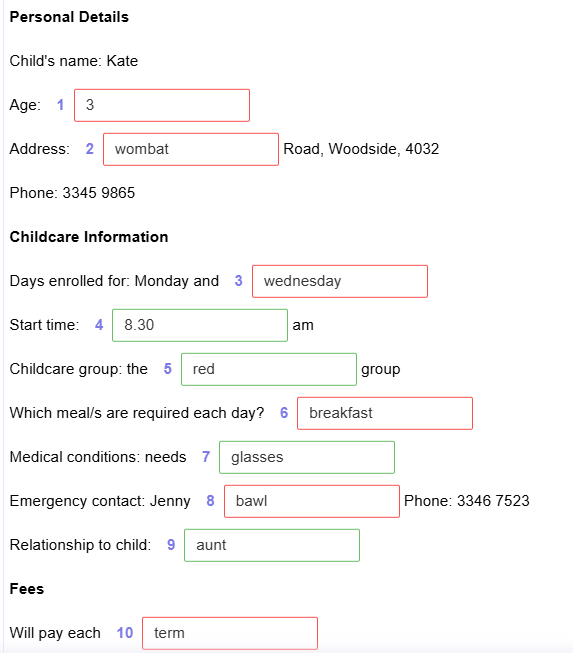

1. She's three now but she turns four next month. I'll put four down because that's how old she'll be when she starts.
2. That's good to hear. And what's your address? It's 46 Wombat Road, that's W-O-M-B-A-T. Woodside 4032.
3. So, have you decided on the days you'd like to bring your daughter here? I'd prefer Monday and Wednesday if possible. Mmm. I'll check, Monday's fine, but I think the centre is already full for Wednesday. Erm. Yes. Sorry. It seems to be a very popular day. We can offer you a Thursday or a Friday as well. Oh dear. I suppose Thursday would be all right because she has swimming on Friday. OK, got that. 

6. OK. Let's move on to meals. We can provide breakfast, lunch and dinner. As she's finishing pretty early, she won't need dinner, will you give her breakfast before she comes? Yes, she'll only need lunch.

7. Just the name and number of a friend or family member we can contact in case we can't get hold of you at any time. OK. That'd better be my sister... Jenny Ball. That's B-A-double L. 
8. 
9. You can choose to pay at the end of each term or we do offer a slightly discounted rate if you pay every month. Oh. I'll do that then. 

# 12-5-1

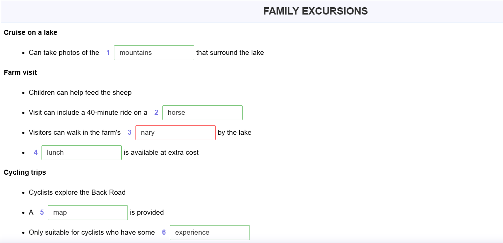

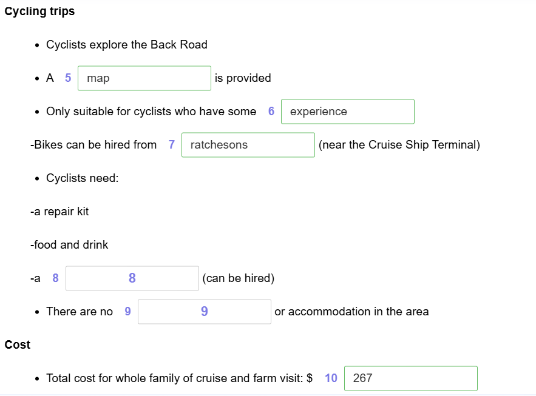

3. There are some very beautiful gardens along the side of the lake which also belong to the farm - they'll be just at their best now. 

8. And I assume I can rent a helmet from the bike place?  Sure, you should definitely get that. It's a great ride, but you want to be well prepared because it's very remote - you won't see any shops round there, or anywhere to stay, so you need to get back in time for the last boat.

# 9-1-1

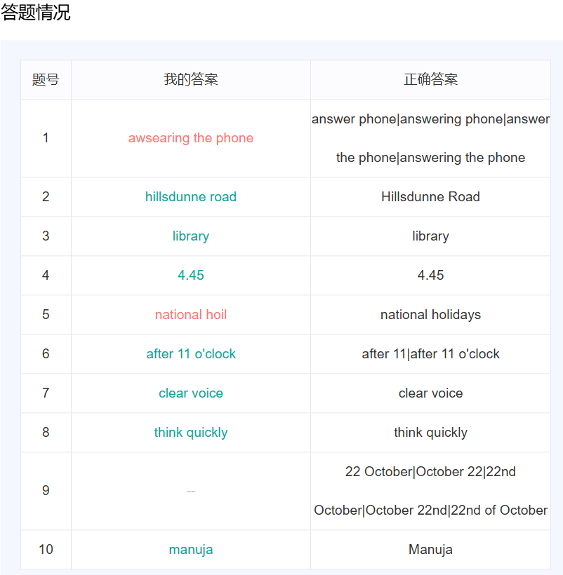

1. what sort of work is it - washing up? It's answering the phone.

5. And we also offer extra pay for working on national holidays.

9. So, when could you come in for an interview? We're actually quite quiet tonight? Sorry, I couldn't come tonight. Or tomorrow, I'm afraid. Thursday's okay - that'd be 22nd of October.

# 16-4-2

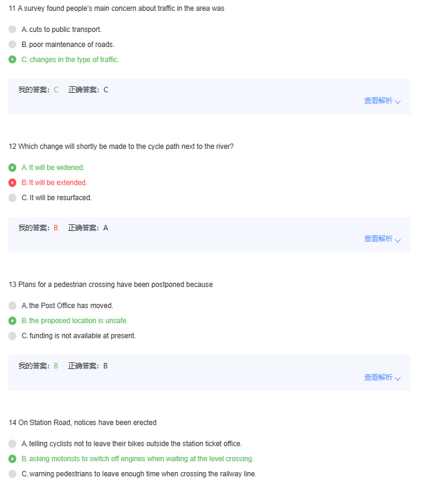

11.There were one or two complaints about potholes which will be addressed, but a significant number of people complained about the increasing number of heavy vehicles using our local roads to avoid traffic elsewhere.

12. The cycle path that runs alongside the river is very well used by both cyclists and pedestrians since the surface was improved last year, but overtaking can be a problem so we're going to add a bit on the side to make it wider.At some stage, we'd like to extend the path so that it goes all the way through the town, but that won't be happening in the immediate future.
13. Now they've confirmed that they're staying where they are, but the Highways Department have told us that it would be dangerous to have a pedestrian crossing where we'd originally planned it as there's a bend in the road there.
14. On Station Road near the station and level crossing, drivers can face quite long waits if the level crossing's closed, and we've now got signs up requesting them not to leave their engines running at that time.

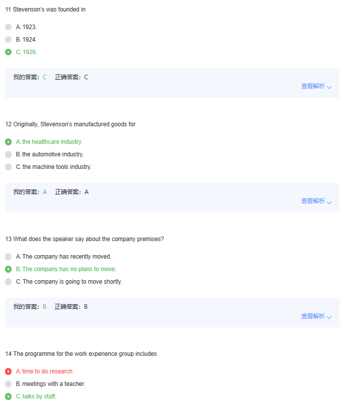

14.Most mornings you'll have a presentation from one of the managers, to learn about their department, starting this morning with research and development.

# 8-2-3

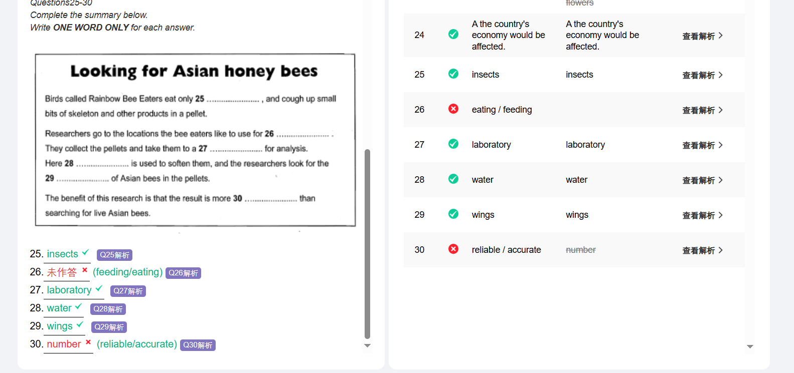

26.In the field we track down the Bee Eaters and find their favourite feeding spots, you know, the places where the birds usually feed.

30.So far our research shows that Asian bees have not entered Australia in any number -it's a good result and much more reliable than trying to find live ones as evidence of introduced insects.

# 9-3-1

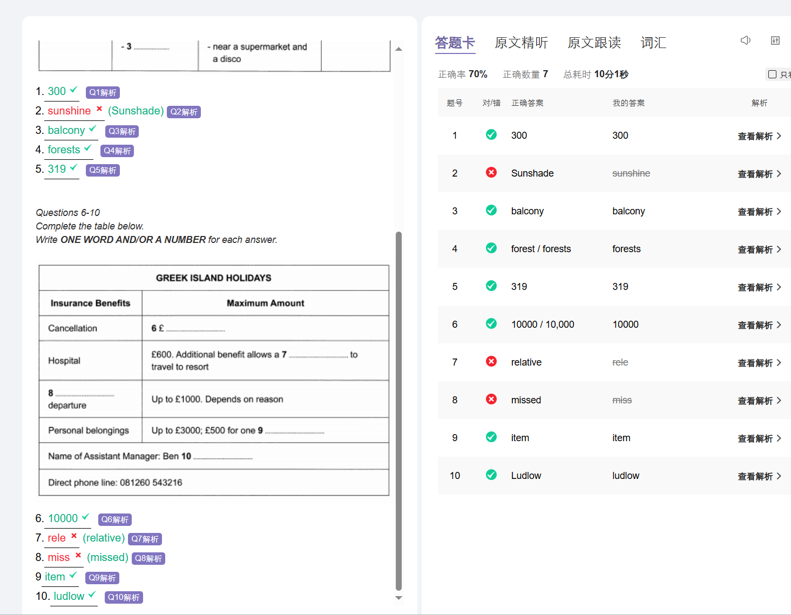

2.I think you meant the Sunshade Apartments.

7.And we also allow a relative to travel to your holiday resort.

8.Don't you have missed departure?

# 13-1-1

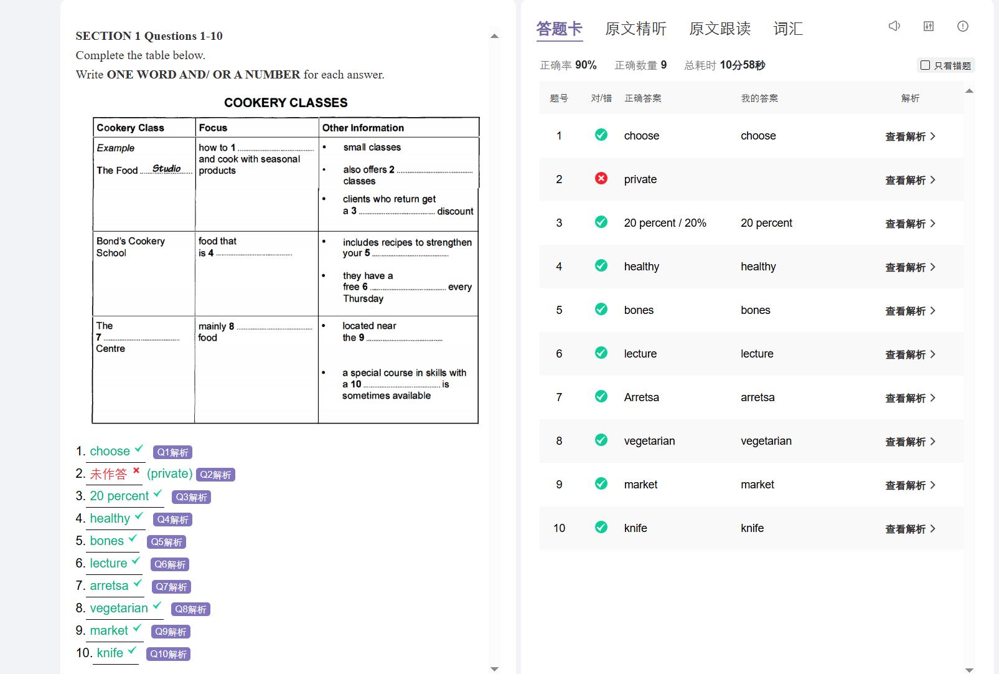

2.Woman: And could I get a private lesson there?	Official: I think so… let me check, yes, they do offer those.

# 11-3-1

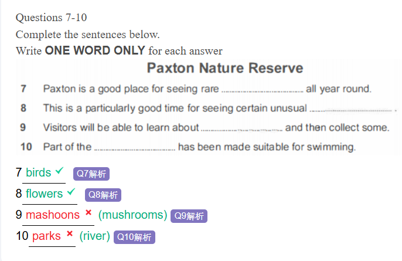

9.And there's going to be a talk and slide show about mushrooms - and you'll be able to go out and pick some afterwards and study the different varieties

10.Uhuh. And is it possible for children to swim in the river?	-Yes. Part of it has been fenced off to make it safe for children to swim in.

# 10-4-2

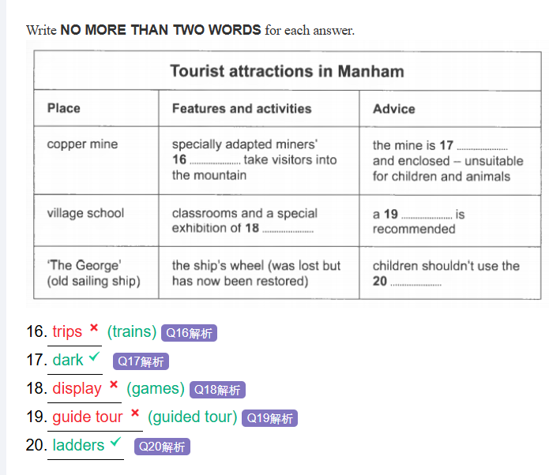

16.Travel on converted mining trains (Q16) and journey into the depths of the mountain along seams once worked by hundreds of miners.

18.While looking round the classrooms, take a special look at our display of games (Q18), which is one of the largest in the world.

# 15-3-3

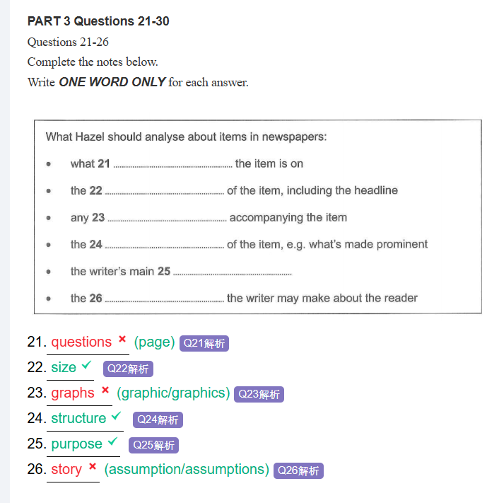

23.And I suppose that includes the headline.
Tom: It certainly does. It's all part of attracting the reader's attention.
Hazel: What about graphics - whether there's anything visual in addition to the text?

26.Gosh, I see what you mean. And I suppose the writer may make assumptions about the reader

# 14-3-3

# 12-8-3

# 12-5-3

