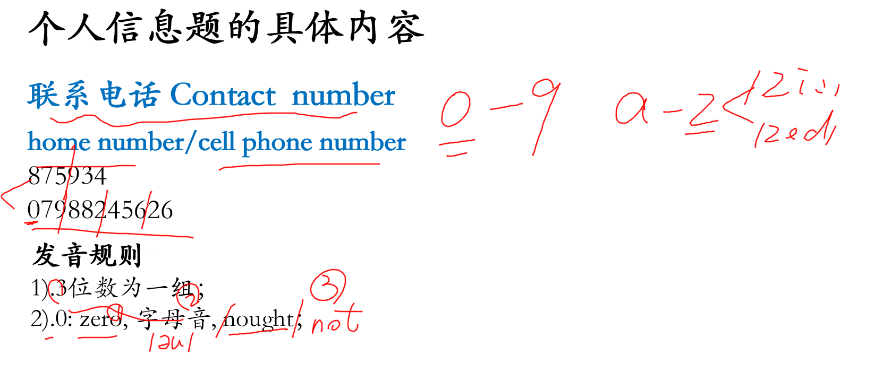
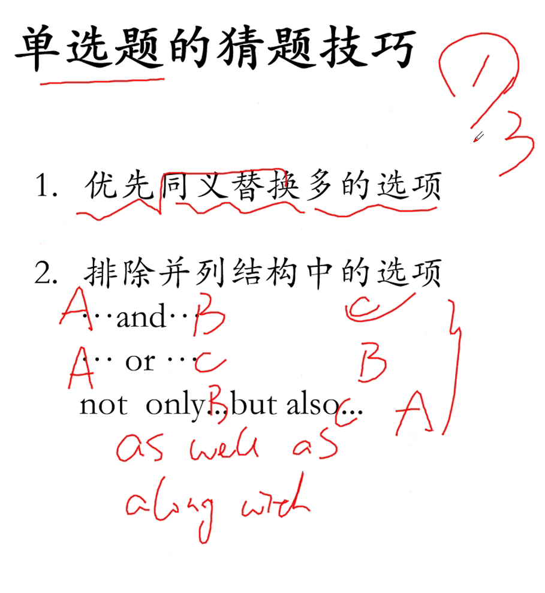
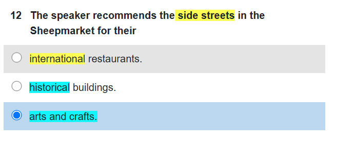
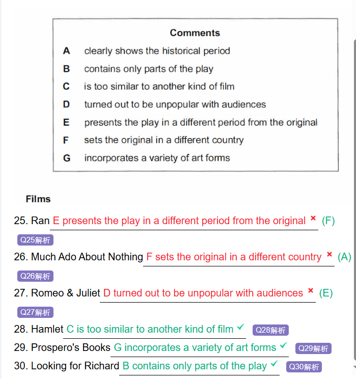
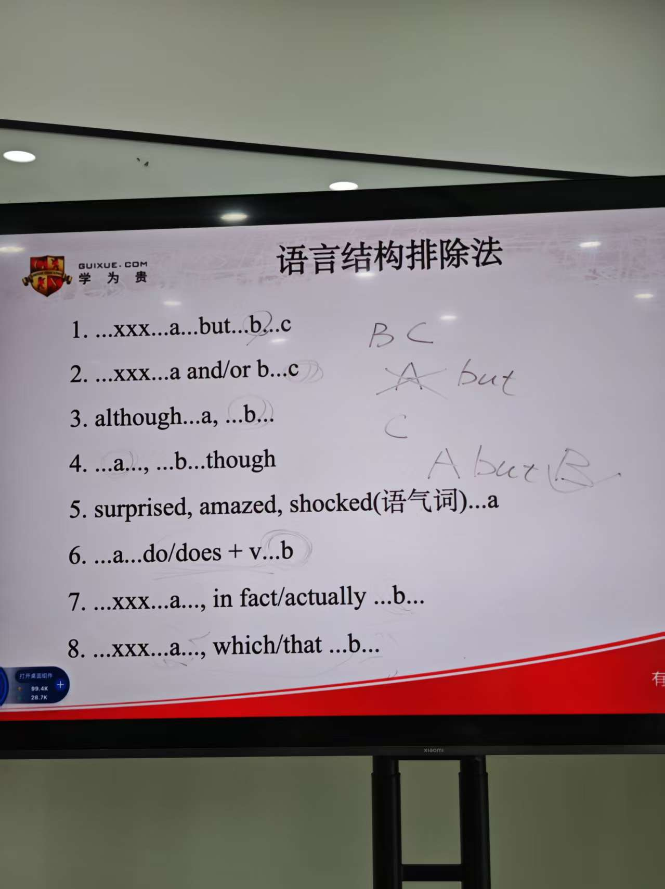
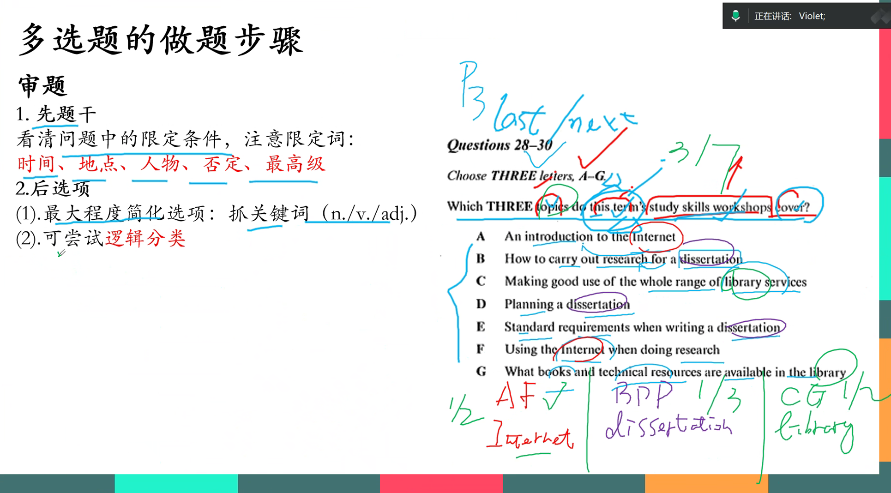
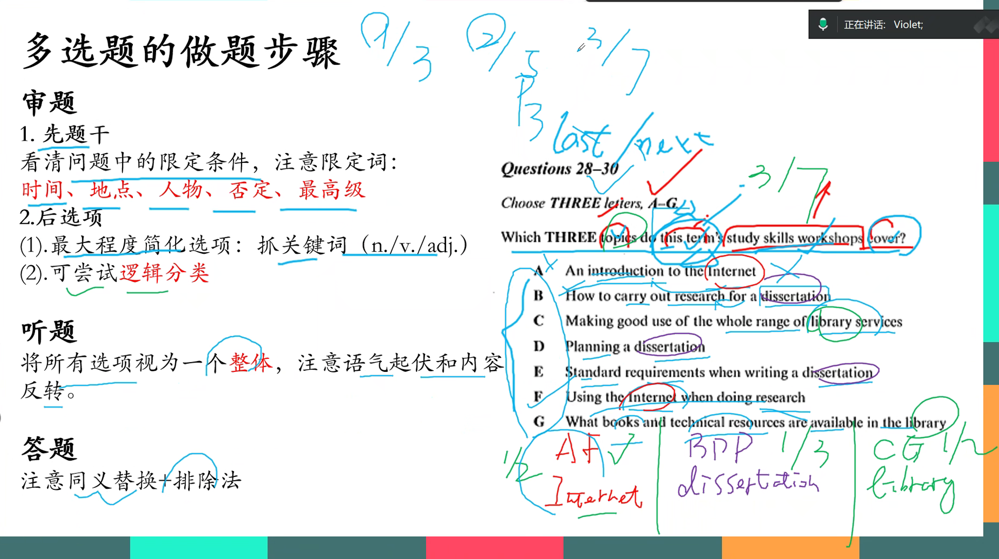
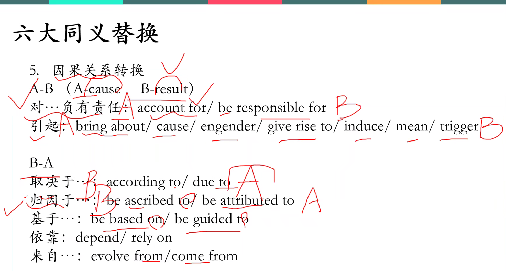
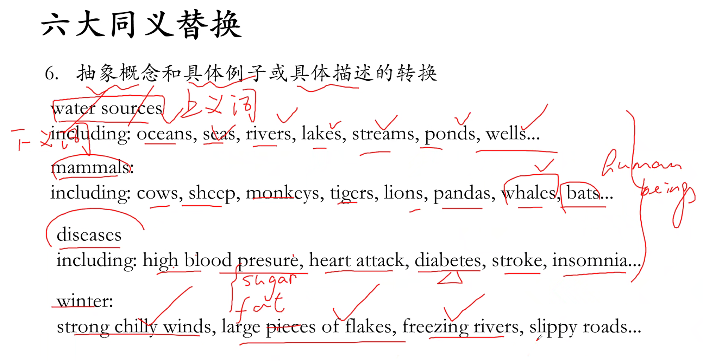
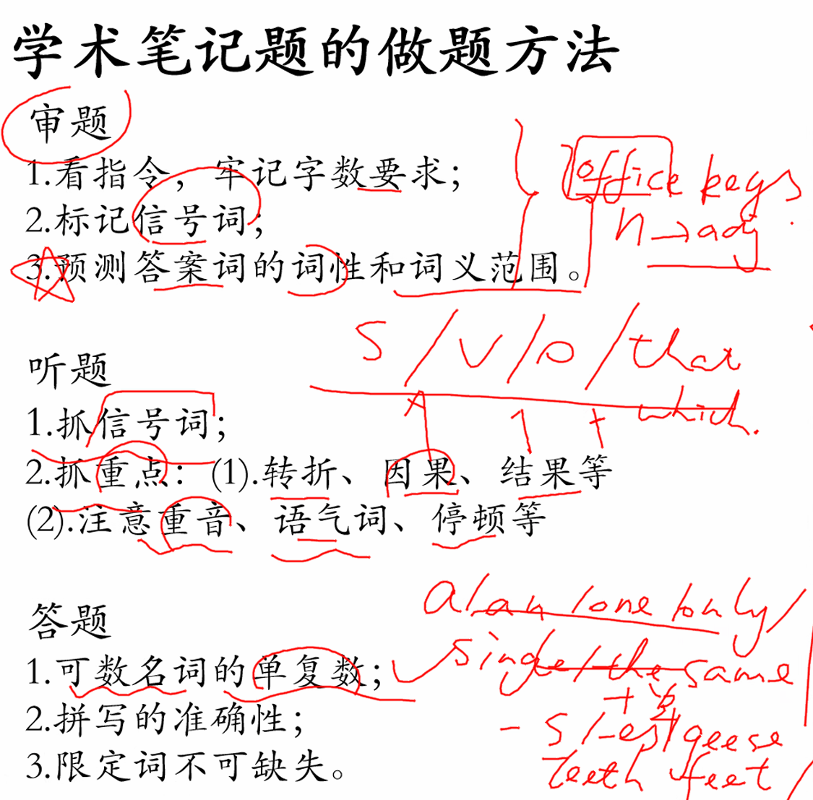

# 听力课堂笔记

同义替换：concern =worry = complain

问答，从句变短语，介词短语可能前置

选择题：

1. 

发音：m和n	w和double u	v和z	**-teen [ti:n]和 -ty[ti]**

it这类的指代词，采取就近原则例如

either A o B... ,it ...	这里指代的是B

housewife	家庭主妇	

garage	车库

off-peak	非高峰时间

elbow	手臂

contact	接触

空格前没有可以画定位的词，空格后出现介词短语，听力中介词短语会前置

instead 附近容易带答案

instead of 一般附近是错误答案

be concrened with 与。。有关联

carnival 嘉年华

# 单选题

先看题目，再看长的回答。

## 同义词，

## 同根词，

## 抽象具体替换

这里historical可能有具体时间的替换（in the past..）

一些抽象词都有可能替换（culture，material）

## 固定替换：上升下降/人/钱/时间/数量多少

排除法：

1. 一致排除

   选项中的关键词原词重现就要排除这个选项
   选项要是3个词以上的

2. 否定排除

3. NG排除

4. 语言结构排除
   转折（but）后出答案（离转折词越近越对）
   并列结构要排除
   instead A 答案就是A （取而代之的是。。。）
   instead of A 排除A（而不是=rather than）
   although/despite/enen though后面是错误答案
   which

   

# 多选题

### 分类标准

**五个选项中三个选项** 结尾**带-s**，三个选项分为一类，其中出一个答案。

**五个选项中三个选项**有且只有两个选项**名词**相同，分一类，一个对，一个错

代词开头it/you 。。一类，冠词开头a/an/the一类，一类出一个答案

两个选项有比较级/最高级，两个都错或者一对一错。

# 同义替换

# 学术笔记题

# 地图

bridge

特殊形状出答案：circle/rectangle/triangle/winding road(弯曲的路)

就近原则法：参照物+方向

footpath = pavement 人行道

corridor 走廊

anonymous 匿名的
