同义替换

1. 近义词
2. 词性变换
3. 反义词替换
4. 归纳总结（最难）

**句子定位原则：题干中找关键词，关键词：名词>动词=形容词**

**题干中需要的找多个关键词协助定位。**

**summary题中需要提前查看题干次数要求和预判词性。**

**summary 里面可能会乱序，要找一个大的范围，可能会收尾乱序颠倒**

**答案是集中的，发现乱序时重新定位（首尾，并列结构）**

climes 地区

hypothesis 假设

threefold 三倍

Break away from 从。。。中脱离（挣脱）

placebo 安慰剂

dutch 荷兰人

fungi 真菌

setting 环境

intensely 

drought 干旱

embark on

stock-rasing 畜牧业

tropical 热带的

account 内容

polarised

credit for

spawn v.大量产（卵）

propaganda n.宣传

sideline v.使退出 n.副业，兼职; （球场等的）边线

superstition n.迷信

mortal 致命的

blow n.打击

hail v.下冰雹

sluggish adj.行动迟缓的,懒散的

fad n.风气

go over to 转向，朝…走去

entail *v.*牵涉;

escalate v.扩大，恶化

peril n.危险; 冒险

indiscriminate adj.随意的

sound adj.明智的

confine n&v. 限制; 监禁

mimic v.模仿

withstand v.经受住; 承受

statue n.雕像

outsider 	

serve v.发球

lead n.铅块

ready-made  adj. 现成的; 做好的

nature n.特性

engender

lethal 

Apart from 除了

reckless 

counter-productive

bask 沉浸于

avidly 贪婪地

proliferation 

wiping out	消灭

plague	n. 瘟疫 v.感染

outlay 

accounted for  归因于

onset

tilt

replenish

malaria

moisture

stakeholder n.利益相关方

summit v.登上顶峰

stroll

mediocrity  

prevail v.流行

wane

# 乱序题

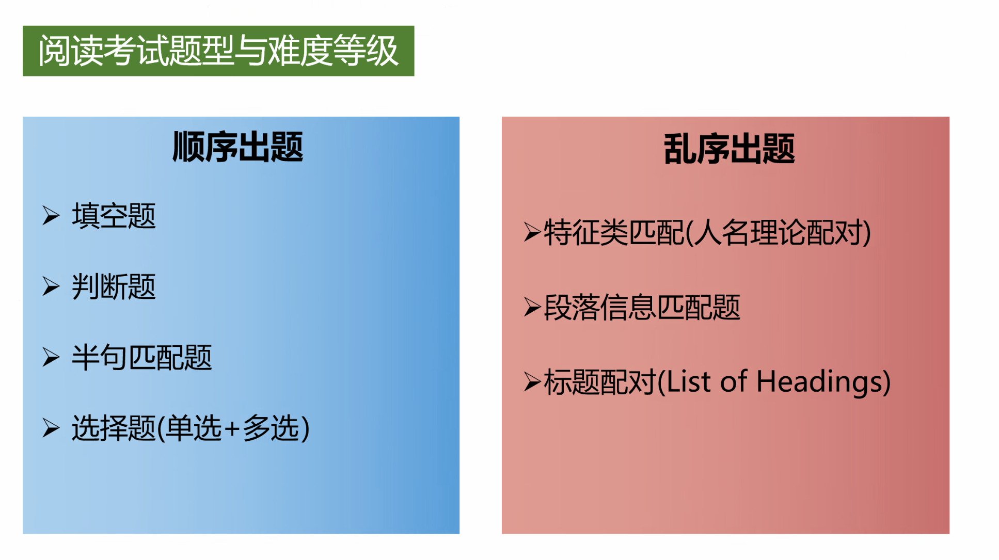

# 匹配题

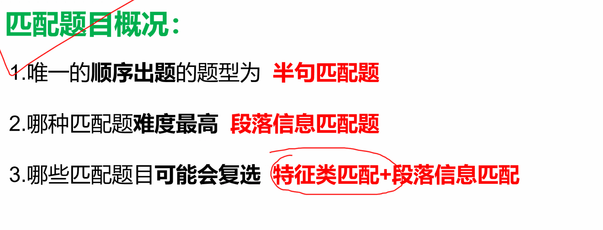

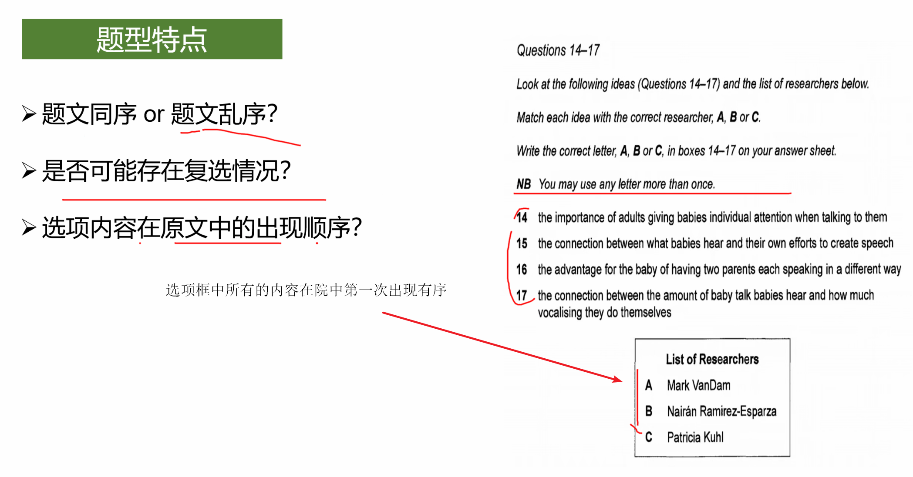

# 并列结构

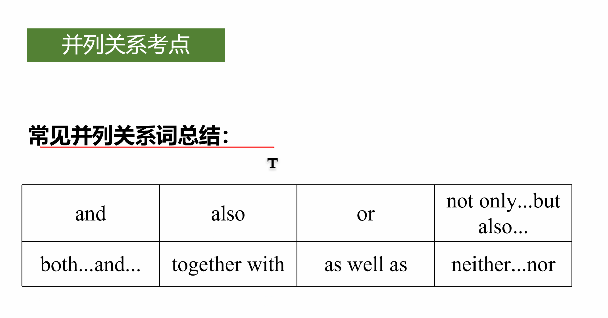

# 判断题

## false

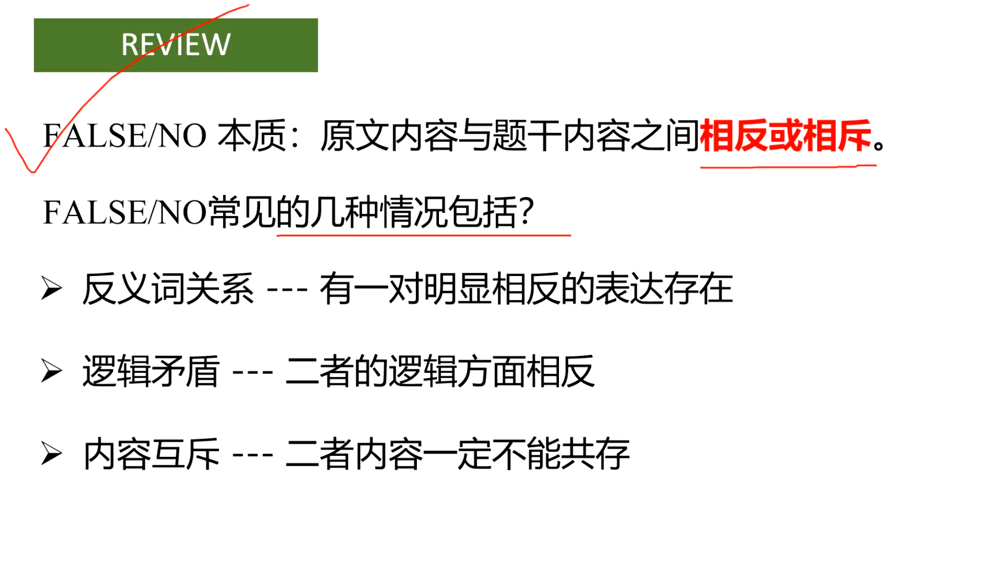

条件过于绝对：only,all,must,every,exclusive(排他的，独一的)，猜题的话就全选false。

**unlikely  不太可能（有点可能） 不等于 impossible（完全不可能）**

注意词的程度：可能性，频率，事实（客观）/观点（主观）

**特别是最后这个：prove和consider，fact/theory**

## not given

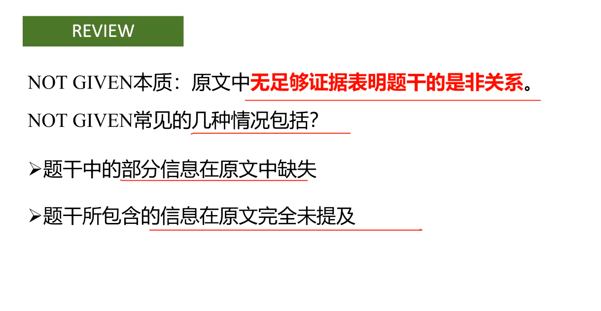

范围的问题：

原文小范围，题目大范围  TRUE

反之 not given

## 比较考点

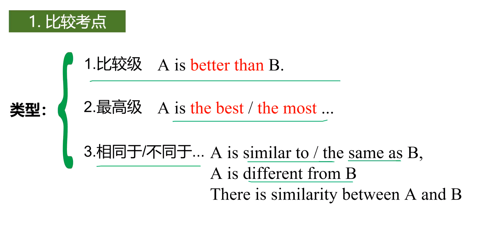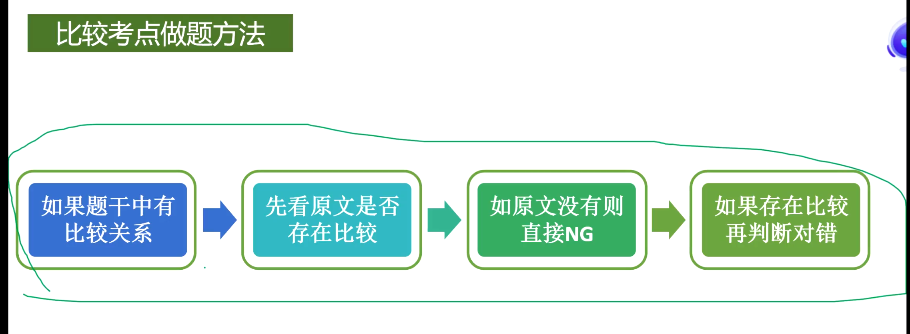

## 绝对词考点

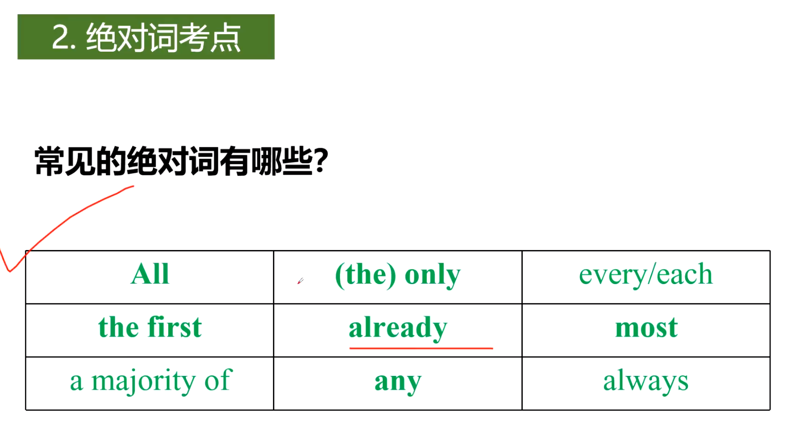

## 因果考点

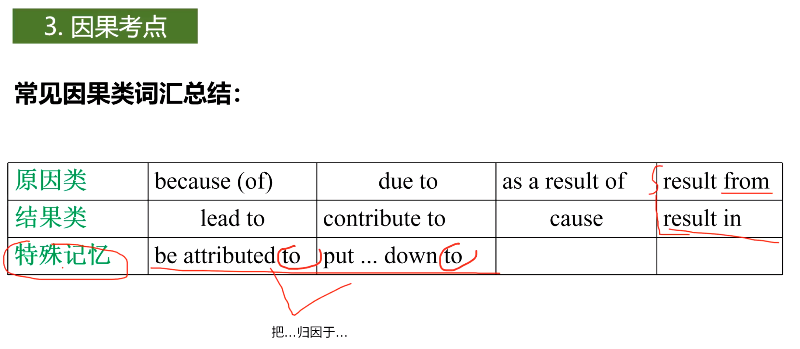

Result from sth	由什么导致的

Result in sth	导致了什么

## 细节考点

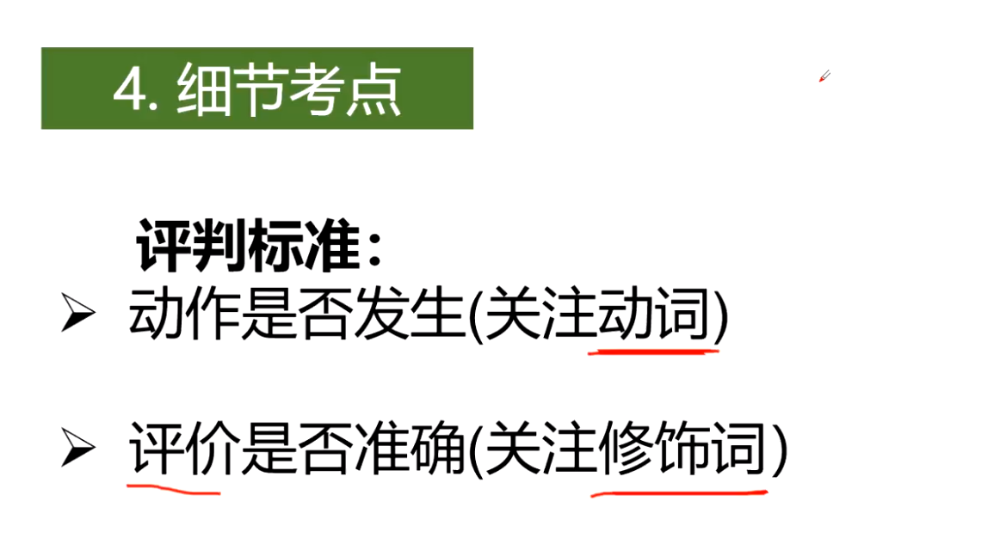

# 图表题

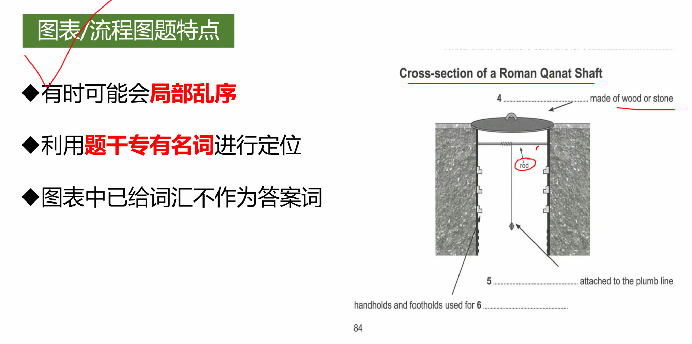

# 主旨题（heading）

1. 找定位词（情感倾向，数字及大写的表达）
2. 略读+扫读，找段落中心句，找到同义替换,**转折词要注意**
3. 排除法做题，
4. 每个段落重复看选项，

高频钱替换

adj. fiscal 财政的 costly,commercial,financial

n, outlay,investment,deposit

v. charge

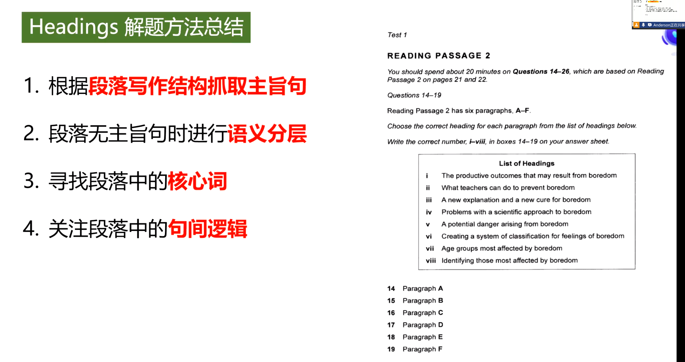

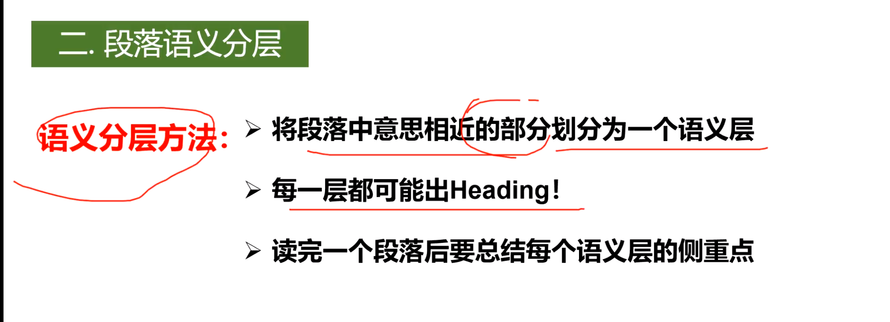

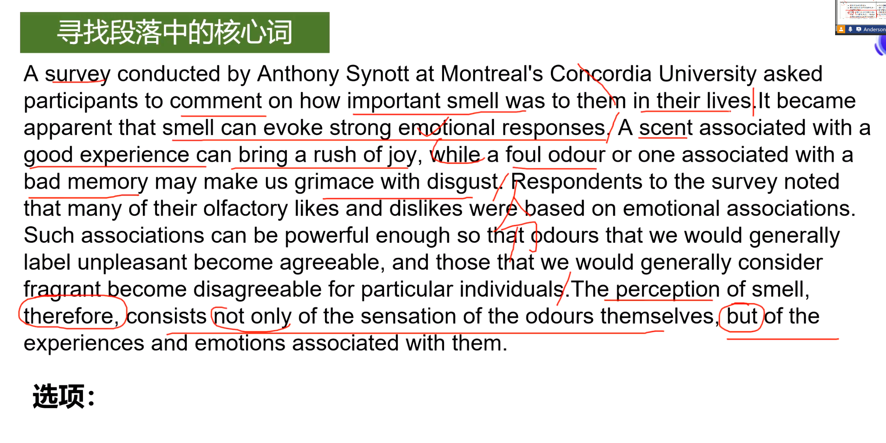

核心词一般就是那些在段落中被反复提到的词（或者是他的同义替换）

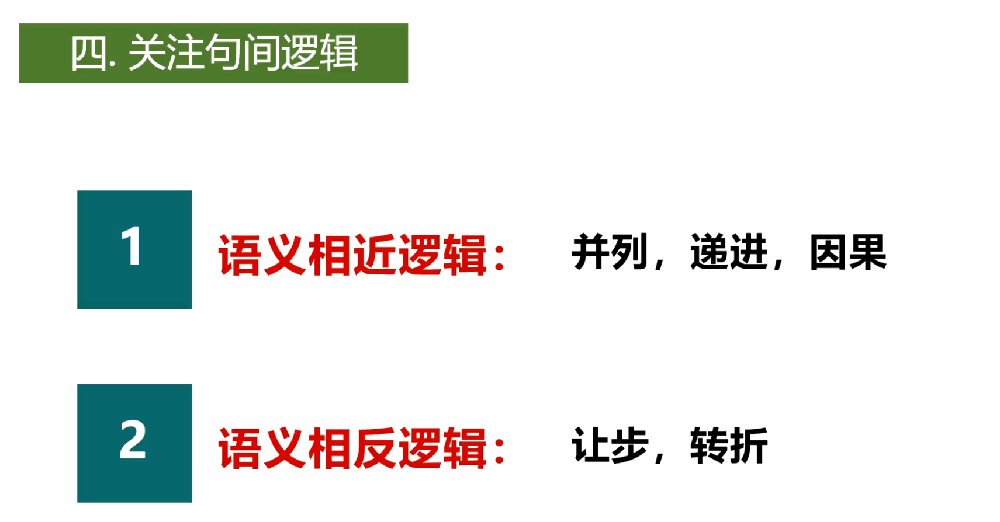

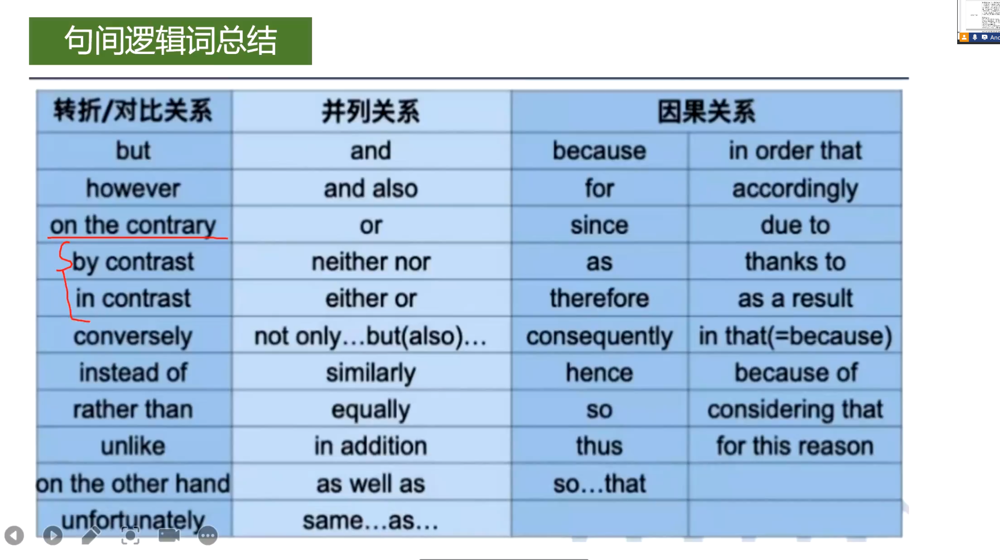

# 选择题

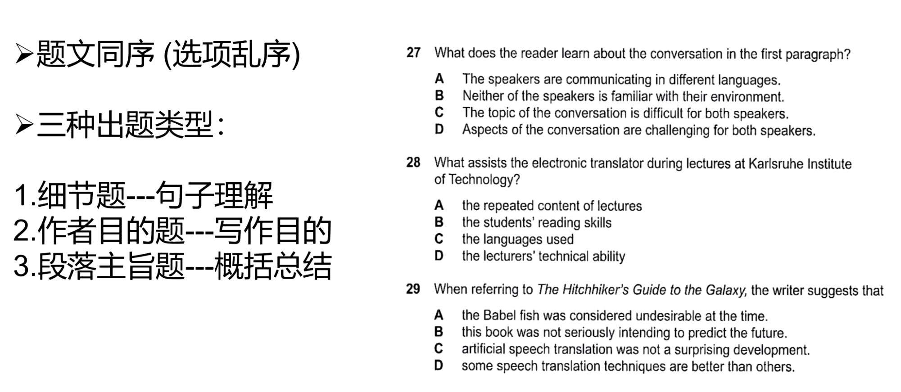

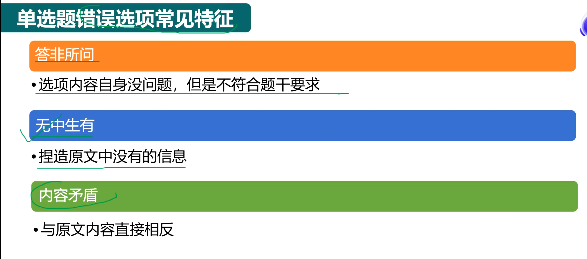

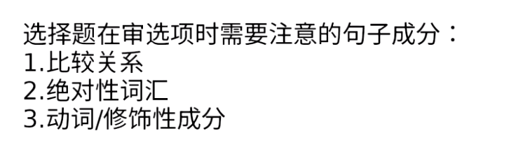

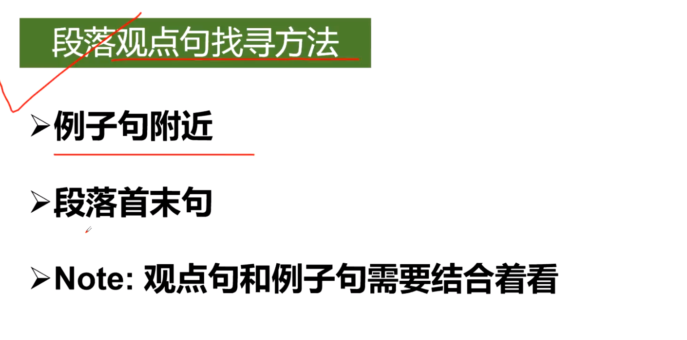

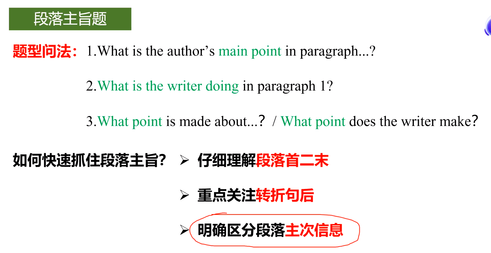

# 熟词生义

1. weight(n)重量，砝码
2. plant 植物，工厂
3. lead  (v)领导 (n)铅
4. coin (n)   硬币（v)制造，铸造

# 同义词

缓解:alleviate=relieve=mitigate=remit

wild swings in大幅波动